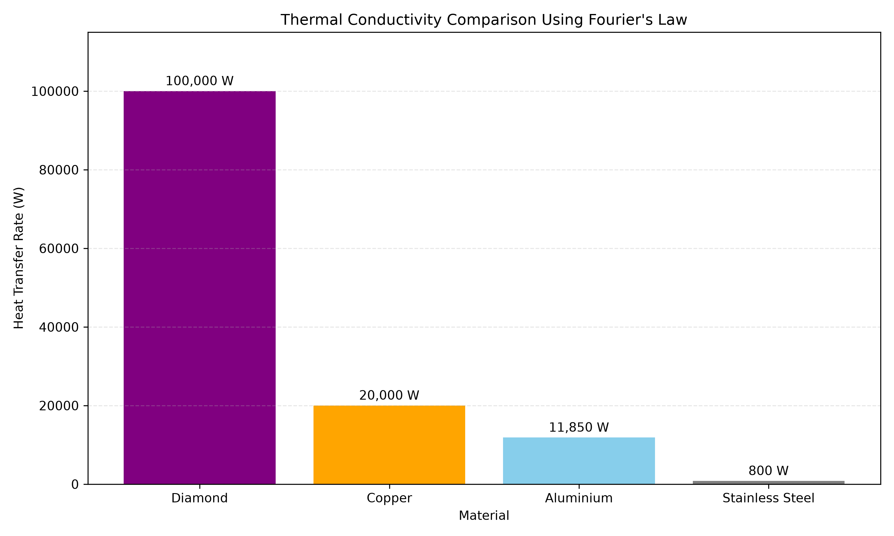

# Thermal Conductivity Comparison Using Fourier's Law

## Project Overview

This project compares heat conduction through four engineering materials: diamond, copper, aluminium and stainless steel.

The aim is to investigate how material thermal conductivity influences heat transfer under identical conditions using Python and Fourier's law.

**Relevant MSc Topics:** Advanced Thermal Systems, Heat Transfer Theory and Design, Materials Engineering.

## Methodology

Fourier's law for steady-state, one-dimensional heat conduction through a flat plate is:

**Q̇ = k × A × ΔT / L**

Where:

- Q̇ = Heat transfer rate (W)
- k = Thermal conductivity (W/m·K)
- A = Cross-sectional area (m²)
- ΔT = Temperature difference (K)
- L = Material thickness (m)

### Model Conditions

- Cross-sectional area: 0.01 m²
- Material thickness: 0.01 m
- Hot-side temperature: 100°C
- Cold-side temperature: 50°C
- Temperature difference: 50 K

Representative material conductivity values are assumed constant.

## Results

| Material | Thermal Conductivity (W/m·K) | Heat Transfer Rate (W) |
|---|---:|---:|
| Diamond | 2000 | 100,000 |
| Copper | 400 | 20,000 |
| Aluminium | 237 | 11,850 |
| Stainless Steel | 16 | 800 |

## Visualisation

## Engineering Discussion

Diamond demonstrates the greatest conductive heat transfer rate, approximately five times that of copper and 125 times that of stainless steel under the specified model conditions.

Its high thermal conductivity makes diamond an attractive material for heat spreaders and thermal management applications in high-power electronics.

CVD diamond is particularly interesting because chemical vapour deposition can produce engineered diamond films and plates. However, thermal performance depends on material quality, defects, interfaces and operating conditions.

## Model Limitations

The model assumes:

- Steady-state, one-dimensional conduction.
- Constant thermal conductivity.
- Uniform material properties.
- Fixed surface temperatures.
- No internal heat generation or thermal contact resistance.

The results are theoretical rather than experimental. The conductivity values are representative assumptions and may vary with temperature, composition and material quality.

## Technologies Used

- Python
- Matplotlib
- Visual Studio Code

## How to Run

Install Matplotlib:

`python -m pip install matplotlib`

Run the program:

`python thermal_conductivity.py`

The program calculates the heat transfer rates and generates a comparison graph.

## Conclusion

Thermal conductivity strongly influences conductive heat transfer. Diamond offers exceptional thermal conduction potential, while copper and aluminium provide practical alternatives for many engineering applications.

This introductory model provides a foundation for more advanced thermal simulations and CVD diamond engineering research.
